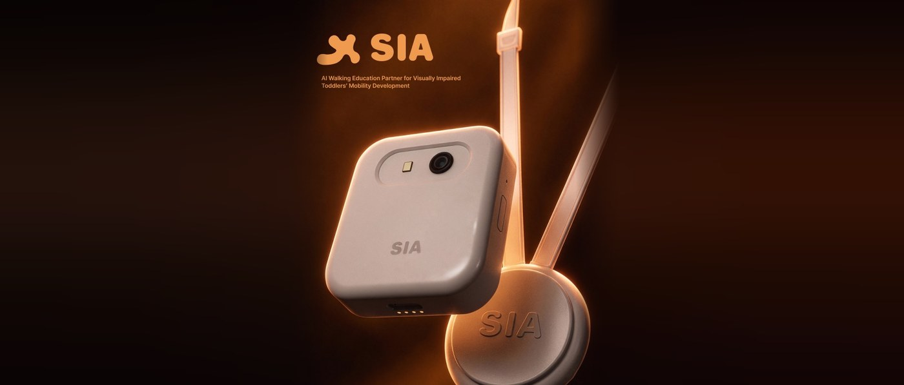
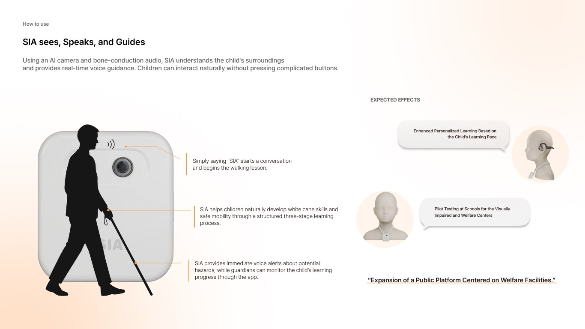
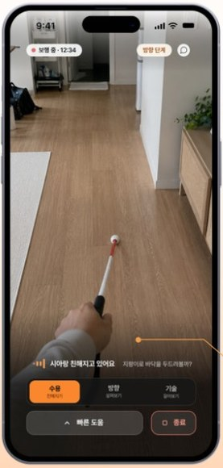
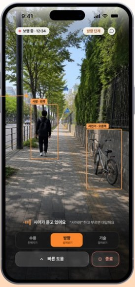
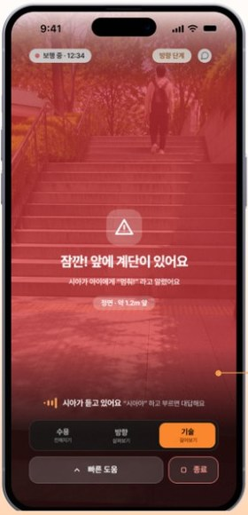
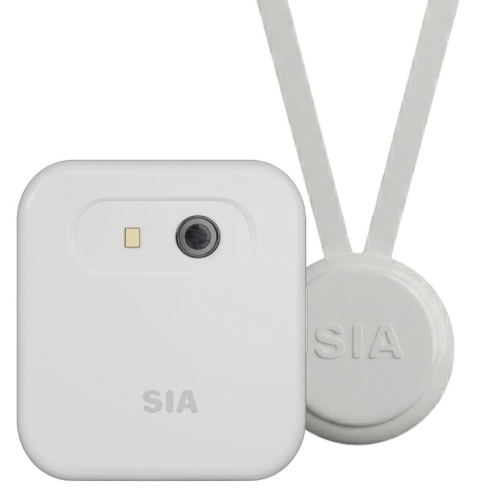
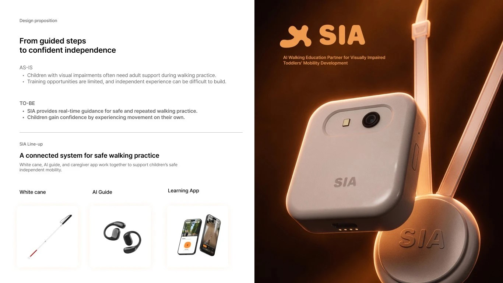

<p align="center">
  
</p>

<h1 align="center">SIA · 시아</h1>

<p align="center">
  <b>시각장애 유아를 위한 AI 보행 교육 파트너</b><br>
  흰지팡이에 달린 작은 친구가 아이와 대화하며 함께 걷는 법을 가르칩니다
</p>

<p align="center">
  
  
  
  
  
</p>

<br>

| 기간 | 팀 | 성과 |
|:---:|:---:|:---|
| 2026.05 – 2026.06 | **CUPID** · 디자인·기계·SW 융합 팀 | 부스 시연 **약 3시간 연속 무중단 운영** · **특허 출원** |

<!-- TODO: 행사명 / 팀 인원 / 특허 표기 방식 팀 합의 -->

---

## 💡 왜 만들었나

| | |
|:---:|---|
| **AS-IS** | 시각장애 아동은 보행 연습 때마다 어른의 도움이 필요하고, 연습 기회가 적어 혼자 걸어 보는 경험을 쌓기 어렵습니다. 흰지팡이도 처음엔 낯설고 무서운 도구입니다. |
| **TO-BE** | 시아가 실시간으로 안내해 주어 안전하게 **반복 연습**할 수 있고, 아이는 스스로 움직여 보며 **자신감**을 얻습니다. |

기존 보조기기의 기계적인 경고음 대신, **아이 눈높이의 따뜻한 대화와 칭찬**으로 보행을 가르치는 것이 시아의 방향입니다.

> [!NOTE]
> **사용 방법 · 3단계 학습 · 디바이스** 섹션은 **제품 비전(디자인 시안)**입니다.
> 앱 화면과 디바이스 렌더는 디자인 결과물이고, 이 레포의 코드가 실제로 구현한 범위는 [구현 범위와 한계](#scope)에 따로 정리했습니다.

## 🦯 이렇게 사용해요

<p align="center">
  
</p>

1. **"시아야"** 하고 부르면 시아가 깨어나 대화를 시작합니다.
2. **3단계 학습**으로 흰지팡이 사용과 안전한 보행을 자연스럽게 익힙니다.
3. 위험이 있으면 **즉시 음성으로 알려 주고**, 보호자는 앱으로 학습 과정을 확인합니다.

## 🪜 3단계 보행 학습

<sub>학습 앱 UX 시안 · 실제 구현은 서버의 단계 모드와 웹 대시보드입니다</sub>

<table>
  <tr>
    <th width="33%">1 · 수용 단계</th>
    <th width="33%">2 · 방향정위 단계</th>
    <th width="33%">3 · 기술 단계</th>
  </tr>
  <tr>
    <td align="center"></td>
    <td align="center"></td>
    <td align="center"></td>
  </tr>
  <tr>
    <td>시아와 대화하고 미션을 하며 흰지팡이와 <b>친해집니다</b>.</td>
    <td>주변을 인식해 <b>"왼쪽에 사람, 오른쪽에 자전거"</b>처럼 말로 안내하고, 아이는 방향 감각을 익힙니다.</td>
    <td>계단·장애물 같은 위험을 <b>먼저 경고</b>하고, 대처하는 방법을 대화로 배웁니다.</td>
  </tr>
</table>

## 🔧 디바이스

<sub>제품 디자인 렌더 · 시연 프로토타입은 ESP32-CAM 보드와 초음파 센서로 제작했습니다</sub>
<!-- TODO: 실제 프로토타입 사진이 있으면 렌더 옆에 추가 -->

<table>
  <tr>
    <td width="45%" align="center"></td>
    <td>
      <b>SIA 라인업</b><br><br>
      🦯 <b>흰지팡이</b> — 디바이스를 스트랩으로 장착<br><br>
      📷 <b>AI 가이드</b> — ESP32-CAM 카메라 + 초음파 거리 센서<br><br>
      🎧 <b>골전도 이어폰</b> — 주변 소리를 막지 않고 시아의 목소리 전달<br><br>
      📱 <b>학습 앱</b> — 학습 단계 진행과 보호자 확인
    </td>
  </tr>
</table>

## 🧠 시스템 구조

```
[ESP32-CAM + 초음파 센서]
      │  영상 스트림 / 거리 (Wi-Fi)
      ▼
[노트북 서버 · FastAPI]
      ├─ 비전  YOLOv8n 객체 탐지 → 방향·거리 판단
      ├─ STT   Google 음성인식 / faster-whisper(로컬) 중 선택
      ├─ LLM   Gemini / Groq / OpenAI 중 선택  ← 탐지 결과를 문장으로 받음
      └─ TTS   Edge-TTS (실패 시 Gemini TTS·gTTS) → 골전도 이어폰
      │  WebSocket
      ▼
[React 대시보드]  영상 · 대화 자막 · 학습 단계 제어
```

- 시연 MVP는 연산을 노트북 서버에서 처리하고, 디바이스는 영상과 거리만 보냅니다.
- 약 3분짜리 체험을 서버를 끄지 않고 **약 3시간 동안 반복 운영**했습니다.

자세한 흐름과 안정성 설계: [showcase/architecture.md](showcase/architecture.md)

<a id="scope"></a>

## ✅ 구현 범위와 한계

이 레포의 코드는 **부스 시연용 MVP**입니다. 비전과 실제 구현은 아래처럼 다릅니다.

| 항목 | 비전 (디자인) | 실제 구현 (이 레포) |
|---|---|---|
| 연산 위치 | 디바이스·스마트폰에서 동작 | **노트북 서버**에서 처리. 디바이스는 영상과 거리만 Wi-Fi로 전송 |
| 학습 앱 · 보호자 확인 | 모바일 학습 앱, 보호자 모니터링 | ❌ 미구현. 운영자용 **React 웹 대시보드**(영상·자막·단계 제어)로 대체 |
| 1단계 · 수용 | 대화와 미션으로 지팡이와 친해지기 | ✅ 호출어("시아야") 기반 LLM 대화. 데모 모드에서는 미리 만든 답변 사용<br>❌ 미션·학습 진도 관리 없음 |
| 2단계 · 방향정위 | 주변 환경 안내 | ✅ YOLOv8n 객체 탐지 → 왼쪽/가운데/오른쪽 판단 (최근 5프레임 다수결로 안정화)<br>✅ 아이가 물어보면 탐지 결과를 문장으로 바꿔 LLM이 답함. "어디로 가?" 같은 길 질문은 규칙 기반 안내로 바로 답함<br>❌ 묻지 않아도 먼저 말하는 자동 안내는 응답 지연 문제로 껐음 |
| 3단계 · 기술 | 계단 등 위험 요소 경고 | ✅ 초음파 기준 거리(기본 30cm) 안 장애물 긴급 경고, 가까운 사람·의자·소파·테이블·화분 경고 (미리 녹음한 경고 음성)<br>❌ 계단·턱·웅덩이 감지 못함 |
| 개인 맞춤 학습 · 파일럿 | 기대 효과 | ❌ 미구현 (향후 계획) |
| 입력 · 언어 | 음성 | ✅ 음성 호출 + 블루투스 버튼 수동 녹음, 한국어/영어 전환 |

### 한계
- **네트워크 의존**: 노트북과 디바이스가 같은 Wi-Fi(핫스팟)에 있어야 하고, LLM과 TTS는 클라우드 API라 인터넷이 필요합니다. 실외에서 혼자 동작하지 않습니다.
- **시각 인식**: 사전학습된 YOLOv8n(COCO 80종)을 그대로 써서 계단·연석 같은 보행 특화 장애물을 모릅니다. 거리는 박스 크기로 추정한 근사값이고, 초음파는 정면 한 방향만 잽니다.
- **장면 이해**: LLM은 카메라 이미지를 직접 보지 않고 YOLO 탐지 결과만 문장으로 받습니다. 그래서 YOLO가 놓친 것은 설명하지 못합니다.
- **검증 범위**: 통제된 부스 환경(약 3m 코스)에서 시연한 결과입니다. 실제 시각장애 아동을 대상으로 한 사용성 검증은 아직 하지 않았습니다. <!-- TODO: 사용자 테스트 여부 팀 확인 -->
- **안전**: 보행 교육을 돕는 프로토타입이며, 실제 보행 안전을 보장하는 의료·보조기기가 아닙니다.
- **코드 품질**: 시연 안정성을 우선한 코드라 일부 테스트가 실패하거나 실제 카메라가 있어야 통과합니다. 로그도 `print` 위주입니다.

### 다음 단계
온디바이스 추론(TFLite / Core ML) · 보행 장애물 데이터로 모델 파인튜닝 · 학습 앱과 보호자 앱 · 맹학교·복지관 파일럿

<!-- TODO: 시연 영상 — README 편집 화면에 mp4(10MB 이하)를 끌어다 놓으면 재생 링크가 생깁니다 -->

## 🖼 포스터

<p align="center">
  
</p>

## 👥 팀

**CUPID** — 제품 디자인, 기구, 소프트웨어가 함께한 융합 팀입니다. 아래는 소프트웨어 파트입니다.

| 역할 | 담당 | GitHub | 상세 |
|---|---|---|---|
| 서버 · 대시보드 | FastAPI/WebSocket 서버, React 대시보드, ESP32 펌웨어, 음성 UX·비전 최적화, 테스트 | [@pinn99k](https://github.com/pinn99k) | [보기](showcase/members/pinn99k.md) |
| AI 코어 | LLM 대화, 길 안내·장면 묘사, 음성 파이프라인, 블루투스 버튼, 영어 버전 | <!-- TODO --> | 작성 예정 |
| 펌웨어 · 하드웨어 | <!-- TODO --> | <!-- TODO --> | 작성 예정 |

> 팀원은 [showcase/members/_template.md](showcase/members/_template.md)를 복사해 자기 페이지를 작성합니다.

## 📁 레포 구조

<details>
<summary>폴더 구조와 담당 보기</summary>

```
.
├── README.md                 # 지금 보는 소개 페이지
├── showcase/                 # 소개 자료
│   ├── architecture.md       #   시스템 구조·흐름
│   ├── members/              #   팀원별 역할 페이지
│   └── assets/               #   포스터·이미지
└── code/                     # 소스 코드 (실행 방법: code/README.md)
    ├── main.py               #   전체 실행·통합 루프          — AI 코어 / 서버·대시보드
    ├── ai_core/              #   비전·LLM·TTS·위험 판단       — AI 코어 (일부 공동)
    ├── server/               #   FastAPI·WebSocket·STT·음성   — 서버·대시보드 / AI 코어
    ├── dashboard/            #   React 모니터링 대시보드      — 서버·대시보드
    ├── firmware/             #   ESP32-CAM + 초음파 펌웨어    — 서버·대시보드
    ├── tests/                #   pytest 단위·통합 테스트
    ├── tools/                #   가짜 디바이스·데모 시뮬레이터
    ├── scripts/              #   음성 생성·점검 스크립트
    └── docs/                 #   개발 문서·ADR·API 명세
```
</details>

## ▶️ 실행

<details>
<summary>실행 방법</summary>

```bash
cd code
python -m venv venv && venv/Scripts/activate      # macOS/Linux: source venv/bin/activate
pip install -r requirements.txt
cp .env.example .env                               # API 키 입력
python main.py                                     # 서버 (기본: 노트북 웹캠)
```

```bash
cd code/dashboard
npm install
npm run dev                                        # http://localhost:5173
```

하드웨어 없이 실행하기, 설정 항목 등은 [code/README.md](code/README.md)를 참고하세요.
</details>

---

<sub>© 2026 CUPID. All rights reserved. 이 레포의 코드와 자료는 포트폴리오 열람용으로 공개하며, 사용·복제·배포 권한은 부여하지 않습니다. 관련 기술은 특허 출원되어 있습니다.</sub>
